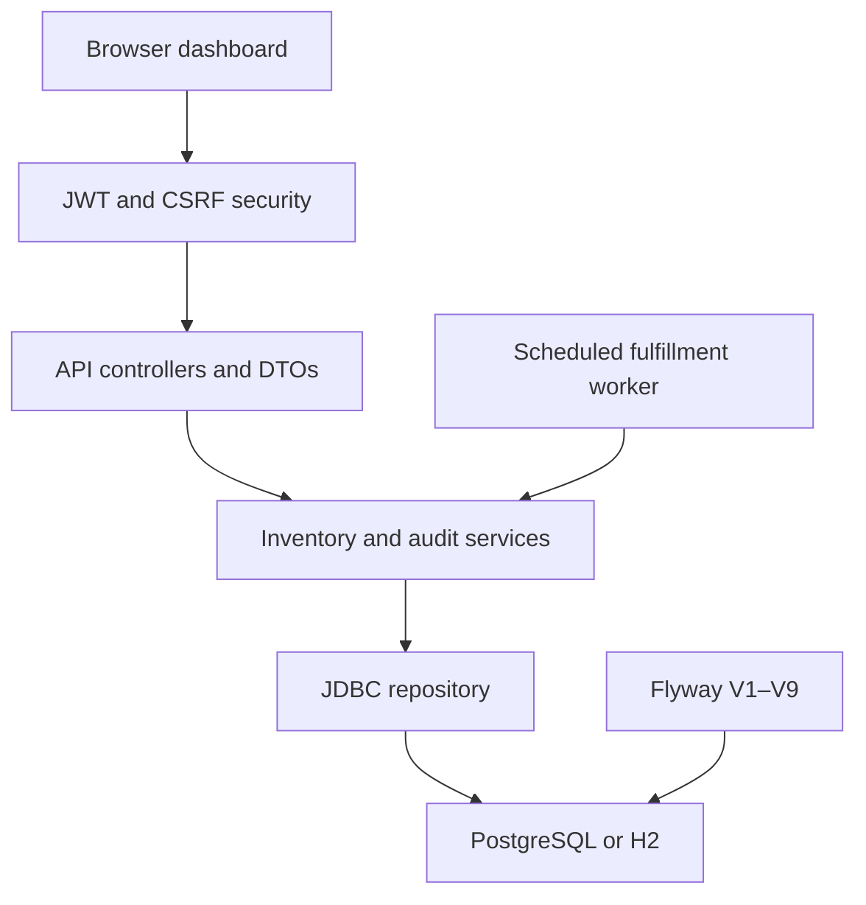

# Stockline

Stockline is a multi-warehouse inventory and fulfillment platform for teams that need one accurate view of stock across several locations. A site can run out while the wider network still has available units; Stockline keeps those warehouse balances separate, finds alternate stock, and records each reservation in a transactional ledger.

**Core capabilities:** network and warehouse inventory, five allocation strategies with read-only previews, split fulfillment, idempotent stock operations, audited inventory history, reconciliation, secure role-scoped accounts, durable event processing, operational metrics, and isolated concurrency/API benchmarks.

**Stack:** Java 17, Spring Boot 3, Spring JDBC, PostgreSQL 16, H2 for local development and isolated tests, Flyway, Spring Security with JWT/CSRF, Micrometer/Actuator, and a responsive vanilla JavaScript dashboard. Maven builds the executable JAR and container image.

## Run from source

Open the **Stockline** folder in VS Code. The folder contains the Maven project file `pom.xml`.

Install Java 17 and Maven. Open a terminal in the same folder and run these commands.

```sh
mvn clean verify
export JWT_SECRET="$(openssl rand -base64 32)"
STOCKLINE_ADMIN_USERNAME=admin STOCKLINE_ADMIN_PASSWORD='change-this-password-123' java -jar target/stockline-1.0.0.jar
```

Open [http://localhost:8080](http://localhost:8080). Stop the server with **Ctrl+C**.

The build packages the dashboard, web server, and database engine in an executable JAR. The first launch seeds three warehouses and five products. The database file is created under `data/` in the working directory. Orders, stock changes, and pending events persist across restarts. Run from the same folder to reopen the same database. Sign in with the bootstrap admin credentials; the password must contain at least 12 characters.

If port 8080 is occupied, run `java -jar target/stockline-1.0.0.jar --server.port=8081` and open [http://localhost:8081](http://localhost:8081).

## PostgreSQL with Docker Compose

For local PostgreSQL, copy `.env.example` to `.env`, replace the database and admin passwords, and set `JWT_SECRET` to `openssl rand -base64 32`. Start both services:

```sh
cp .env.example .env
docker compose up --build
```

Compose waits for PostgreSQL's readiness check before starting the app. Both published ports bind to loopback; open [http://localhost:8080](http://localhost:8080) locally. Check progress with `docker compose logs -f app`. Stop services with `docker compose down`. The `stockline-postgres` volume preserves database data across restarts and `down`; `docker compose down -v` removes the volume and its data.

## Deploy on Render

The repository includes a Render Blueprint in `render.yaml`. It creates one Docker web service and a managed PostgreSQL 16 database in Singapore. The database uses a paid persistent plan; review Render's current pricing before creating the Blueprint. Do not use a temporary/free database for production inventory.

1. Push the reviewed deployment changes to the `main` branch of `https://github.com/raginikalra21/Stockline-` (do not commit `.env`, local databases, or credentials).
2. Sign in to Render, choose **New → Blueprint**, connect GitHub if prompted, and select the `Stockline-` repository and `main` branch.
3. Review the services and database plan shown from `render.yaml`, then create the Blueprint. Render creates the PostgreSQL instance and Docker web service in the same region.
4. Enter `STOCKLINE_ADMIN_USERNAME` and a unique `STOCKLINE_ADMIN_PASSWORD` of at least 12 characters when Render prompts for the two `sync: false` values. Keep the password in Render, not in GitHub or Codex chat. Render generates `JWT_SECRET` and supplies `PORT` automatically.
5. Wait for the build and deployment. In the service logs, confirm Flyway finishes and Spring Boot starts. The health check is `/actuator/health/readiness`; it must report healthy before the app is ready.
6. Open the web service's `onrender.com` URL and sign in with the bootstrap administrator. Create the warehouse manager account and assign warehouse access through **Settings & tools → User management**.

Environment configuration:

| Variable | Source | Purpose |
| --- | --- | --- |
| `PORT` | Render | HTTP port; Spring Boot listens on this value (`8080` fallback for local use). |
| `DB_URL` | Render PostgreSQL `connectionString` | Render supplies `postgresql://…`; the container entrypoint adds the JDBC prefix expected by Spring. |
| `DB_USERNAME`, `DB_PASSWORD` | Render PostgreSQL references | Managed database credentials. Do not copy these into source files. |
| `JWT_SECRET` | Generated by Render | Base64 256-bit signing key. Keep stable across restarts and rotations. |
| `STOCKLINE_ADMIN_USERNAME`, `STOCKLINE_ADMIN_PASSWORD` | Entered in Render | One-time bootstrap account; later user and warehouse administration is in Stockline. |
| `SPRING_PROFILES_ACTIVE=prod`, `STOCKLINE_SECURE_COOKIE=true` | Blueprint | Enables the PostgreSQL production profile and HTTPS cookie protection. |

Render terminates public TLS and forwards requests to the service over its private network. The app trusts forwarded headers, uses a `Secure`, `HttpOnly`, `SameSite=Strict` auth cookie, and retains CSRF checks for cookie-authenticated requests. Do not activate `dev`, `test`, `benchmark`, or `local-demo` alongside `prod`. This repository is prepared for deployment but is not deployed until the Render URL is supplied and verified.

## Single-host Docker deployment guide

For a low-cost single-instance deployment, use a small Linux VM with Docker Engine and Compose, keep PostgreSQL on the attached persistent volume, and put a TLS reverse proxy in front of the app. Copy `.env.example` to `.env`, use unique strong secrets, set `SPRING_PROFILES_ACTIVE=prod` and `STOCKLINE_SECURE_COOKIE=true`, then run `docker compose up --build -d`. The app and database are bound to loopback so the host proxy can reach the app without publishing PostgreSQL. Terminate HTTPS at the proxy and forward the original host and protocol headers; Spring honors forwarded headers in the production profile.

Check startup with `docker compose ps` and `docker compose logs -f app`. Back up before an upgrade and take regular database dumps, for example: `docker compose exec -T database sh -c 'pg_dump -U "$POSTGRES_USER" "$POSTGRES_DB"' > stockline-backup.sql`. Store backups away from the VM and test restores. Keep the database volume on persistent storage. This repository includes a single-host Compose deployment; it does not include automated TLS provisioning, managed-database setup, horizontal scaling, or a cloud deployment.

The local H2 profile remains the default (`dev`) and stores its database in `data/`. `test` uses in-memory H2. `postgres` and `prod` require `DB_URL`, `DB_USERNAME`, `DB_PASSWORD`, and a Base64 `JWT_SECRET`; pool sizes and connection timeout can be set with `DB_POOL_MAX`, `DB_POOL_MIN_IDLE`, and `DB_CONNECTION_TIMEOUT_MS`. Set `STOCKLINE_ADMIN_USERNAME` and `STOCKLINE_ADMIN_PASSWORD` on first startup to provision the initial admin. Later users and warehouse assignments are managed through the admin API.

### Local academic demo profile

Build the application, then explicitly initialize the demo accounts in the local H2 database. Supply local-only demo account values through environment variables first; the credentials are not stored in the packaged app:

```sh
mvn clean package
export STOCKLINE_DEMO_ADMIN_USERNAME='local-admin'
export STOCKLINE_DEMO_ADMIN_PASSWORD='replace-with-a-unique-12-character-password'
export STOCKLINE_DEMO_MANAGER_USERNAME='local-manager'
export STOCKLINE_DEMO_MANAGER_PASSWORD='replace-with-a-unique-12-character-password'
java -jar target/stockline-1.0.0.jar --spring.profiles.active=local-demo --stockline.demo.initialize=true
```

Open `http://127.0.0.1:8080` (the demo listener binds to IPv4 loopback). The `local-demo` profile includes the normal H2 `dev` profile and displays the supplied credentials beneath the login form. The Use buttons only fill the form; you must still click **Sign in**. Starting without `--stockline.demo.initialize=true` never resets passwords. To reset those two demo accounts again, stop the app and run the same initialization command. To hide demo credentials, start with the default `dev` profile instead. The demo profile refuses to run with `prod`, and the production profile rejects development/test profiles and demo initialization/display flags. Do not expose the local demo listener to a network.

Flyway V9 narrows application roles to `ADMIN` and `WAREHOUSE_MANAGER`. Existing `INVENTORY_OPERATOR` accounts are converted to disabled warehouse managers while their warehouse assignments are retained; an administrator must review and explicitly re-enable any account. Historical movement actor values remain unchanged.

Flyway migrations are under `src/main/resources/db/migration/`: V1 creates the base catalog and inventory schema; V2 adds the movement ledger, idempotency, and fulfillment outbox; V3 adds inventory buckets and thresholds; V4 adds movement ordering and query indexes; V5 adds accounts, warehouse access, and audit actor references; V6 adds the multi-event outbox, attempt history, worker leases, and replenishment suggestions; V7 adds warehouse allocation settings and persisted allocation decisions; V8 adds request correlation to outbox events and indexes for status-filtered order, failure, and attempt queries; V9 narrows application roles and disables legacy operator accounts for review. New databases apply V1 through the latest version. A non-empty pre-Flyway database is baselined at version 0 and receives migrations without replaying seed inserts or changing balances. Back up a production database before deploying any application upgrade.

## Walkthrough

## Authentication and permissions

The API uses stateless, 20-minute HS256 JWTs in an HttpOnly `STOCKLINE_AUTH` cookie. Mutating cookie-authenticated requests require the CSRF token from `GET /api/auth/csrf` in `X-XSRF-TOKEN`; the browser client handles this automatically. Passwords use BCrypt. Non-browser clients may send bearer JWTs. Login, current-user, and logout endpoints are `POST /api/auth/login`, `GET /api/auth/me`, and `POST /api/auth/logout`.

| Role | Access |
| --- | --- |
| `ADMIN` | All warehouses, catalog, network totals, analytics, audits, event log, concurrency lab, and user management. Can configure allocation strategies and warehouses. |
| `WAREHOUSE_MANAGER` | Inventory, low-stock alerts, movement history, orders, and permitted stock operations for assigned warehouses; cannot access user management, reconciliation, event administration, or system-wide settings. |

Create users through `POST /api/admin/users`; update role, enabled state, and warehouse assignments with `PUT /api/admin/users/{id}`. Users can change their password through `POST /api/auth/password`. Movements record username, user ID, and role. Automatic fulfillment and opening balances use actor `SYSTEM`. API reference: [Swagger UI](http://localhost:8080/swagger-ui.html) and `/v3/api-docs`; both are disabled in the `prod` profile.

| Screen | What to try |
| --- | --- |
| Dashboard | See five role-scoped figures: products, available stock, reserved stock, active orders, and low-stock locations. Review recent orders, warehouse balances, low stock, and quick actions. |
| Inventory | Search products, inspect physical, available, reserved, and damaged balances by warehouse, compare network totals, review location status, and open product-level warehouse balances. Restock or transfer stock where authorized. |
| Warehouses | Review location status, product count, available stock, and low-stock count. **View warehouse** opens inventory, recent movements, relevant orders, and low-stock items. Administrators can also add or configure locations. |
| User management | Administrators can create and enable/disable the two supported account roles and assign warehouse managers to locations. This is in the secondary Settings & tools menu, not primary navigation. |
| Orders | Preview one of five allocation strategies, optionally specify a preferred warehouse or destination coordinates, then reserve from one or multiple locations. View persisted allocation decisions and filter by status. |
| Event Log | Filter all event types and states, inspect processing attempts and timestamps, review retry/dead-letter status, and retry eligible dead-letter events. Managers can view and dismiss replenishment suggestions for assigned warehouses. |
| Inventory History | Search the movement ledger and review assigned warehouse thresholds. Administrators can run bucket-level reconciliation. |
| Concurrency Lab | Compare database-backed naive, optimistic, and pessimistic reservations using fresh isolated H2 databases. Inspect actual correctness, ledger integrity, lock waits, retries, and latency. |
| Operations Health | Admin-only live readiness/liveness, database and worker status, outbox depth, ledger integrity, HTTP latency, JVM, and Hikari metrics. |

## Screenshots

Browser screenshots and measured results for six phone, tablet, and desktop viewports are available in [the responsive audit](docs/phase-9-audit.md#mobile-responsiveness-audit) and the [responsive screenshot index](docs/responsive-audit/README.md).

### Five-minute classroom demo

1. In a fresh database, place a **15-unit order for KB-104 with Punjab Central selected**. Punjab Central supplies eight units and North Hub supplies seven. The allocator uses one location first whenever a single location can fulfill the full order; otherwise it splits the remainder by a deterministic warehouse order.
2. Add iPhone 17 if needed, then restock Punjab Central with 50, North Hub with 30, and South Hub with 20. Place a 50-unit order with Punjab Central selected. Punjab reports zero available while the network still has 50 and the product stays available. Place another 50-unit order with Punjab selected. The allocator uses North and South, and the network status becomes out of stock. The view reads persisted inventory rows.
3. Wait about **12 seconds**. The background worker marks the pending orders fulfilled. Reserved balances drop and shipped balances increase.
4. Place a second order and select **Cancel order**, then **Confirm cancellation** while the order is reserved. The exact allocated units return to their warehouses.
5. Run **Concurrency Lab** with 100 buyers, 10 starting units, and one unit per buyer. Compare all three transaction strategies. In the deterministic H2 setup, naive mode can accept stale reads and report lost reservations; optimistic and pessimistic modes should accept at most 10. Optimistic mode uses the production version-checked service; pessimistic mode takes ordered row locks.
6. Try 50 buyers with 11 units and three units per buyer. Expect three accepted orders, 47 rejected orders, and two remaining units in either safe strategy.

The lab supports 10, 50, 100, 250, 500, or 1,000 buyers, configurable stock, warehouse count, quantity, worker count, maximum duration, one to five repetitions, and an individual or comparison run. Combined requested simulation time is capped at 15 minutes. Each strategy starts with a fresh H2 database populated from the same schema and stock distribution. All three execute database transactions at `READ_COMMITTED`; only the naive simulation uses a coordination barrier, after database reads, to make stale read-modify-write collisions reproducible. No barrier is used by production reservations. At this isolation level, H2 permits a read to become stale before an unguarded write; other engines or stricter isolation may serialize or abort the same race. Optimistic conflicts count actual failed version predicates; retries count fresh attempts. Pessimistic wait time measures time spent acquiring ordered `SELECT FOR UPDATE` locks. Request latency includes queue time; the UI separately reports summed queue wait and cumulative transaction execution time, subtracting simulation-only barrier duration. Naive transactions may commit inconsistent ledger chains by design, but the database is disposed after the run and production inventory is never connected. H2 results demonstrate correctness and local behavior; they are not production-scale performance claims.

The **Real API benchmark report** panel is separate from the concurrency simulation. Select a JSON result file produced by `scripts/run-benchmark.sh`; the browser checks its schema, isolation metadata, request accounting, and inventory invariants before rendering it. The selected file is read in the browser and is not uploaded. Invalid or failed reports are not displayed.

## How it works



- **Network inventory.** Each product/warehouse pair has its own inventory row. Available, reserved, damaged, shipped, and written-off buckets remain location-specific. Network totals are SQL aggregates of those persisted rows; product status is available whenever any warehouse has available units. Warehouse status is based on its own available balance.
- **Allocation.** The service merges duplicate SKU lines and reads a consistent candidate snapshot. Strategies are `SINGLE_WAREHOUSE`, `NEAREST_WAREHOUSE`, `FEWEST_SPLITS`, `MAXIMUM_AVAILABILITY`, and `COST_OPTIMIZED`. The default nearest strategy first chooses the nearest eligible warehouse that can cover the complete order and capacity; only if none can do so does it split deterministically by preference, priority, and warehouse code. Distance uses configured coordinates; cost uses configured handling and per-unit shipping estimates. The remaining strategies are deterministic heuristics, not globally optimal solvers. Inactive/maintenance sites and stock outside the available bucket are ineligible. Preview is read-only; order placement locks warehouse settings, refreshes candidates, replans, and reserves all rows in one transaction with version checks and retry. Persisted decisions include strategy, per-allocation estimated cost/distance, reason, and lifecycle status.
- **Optimistic concurrency.** Every stock row carries a version. The update includes `WHERE sku = ? AND warehouse_code = ? AND version = ?` and increments the version when it succeeds. When a concurrent change makes a snapshot stale, the update affects zero rows. The service rolls back and retries in a fresh transaction with current balances.
- **Concurrency strategy lab.** `RaceStrategy` separates naive, optimistic, and pessimistic implementations. Every run owns a disposable in-memory H2 database initialized from Flyway migrations; all begin from the same warehouse distribution and use `READ_COMMITTED`. The naive strategy writes stale absolute balances without a version predicate or explicit lock. Optimistic mode calls `InventoryService.place`. Pessimistic mode locks rows with `SELECT FOR UPDATE`, ordered by SKU and warehouse code, before planning a split reservation. Each database transaction commits orders, allocations, outbox events, stock changes, and ledger movements atomically.
- **Atomicity.** The order, allocations, available-to-reserved movements, and outbox event commit together. A failed line leaves the whole order uncommitted. Transfers also commit both warehouse changes together. Stock writers use a consistent SKU and warehouse-code order.
- **Durable events.** Business transactions insert versioned events into `outbox_events` atomically with their stock/order changes. Events move through `PENDING → PROCESSING → COMPLETED`, with `RETRY_WAIT` and `DEAD` failure paths. PostgreSQL workers claim bounded batches with `FOR UPDATE SKIP LOCKED`; expired leases recover abandoned claims. Delivery is at least once, with idempotent order transitions and event handlers; it is not exactly-once delivery. H2 uses its own blocking row-lock query for local tests and does not model PostgreSQL's skip-locked concurrency.
- **Event retries.** Retryable failures use bounded exponential backoff with full jitter and a configurable maximum attempt count. Permanent validation failures go directly to dead letter. Administrators can manually retry eligible retryable dead-letter events; doing so restarts the attempt counter while preserving attempt history.
- **Replenishment.** A below-threshold transition creates one `LOW_STOCK` event for that condition. Its handler creates an idempotent suggestion from current warehouse balances. Restocking above threshold clears an active suggestion; purchasing and restocking remain human decisions.
- **Cancellation.** The worker and cancel action both update the order only while its status is `RESERVED`. One transition wins. Cancellation returns reserved stock to the original allocations and closes the event in the same transaction.
- **Duplicate requests.** `requestKey` is a client-generated UUID stored under a unique constraint. Repeating a successful request with the same customer and SKU quantities returns the existing order. Using that key with a changed payload returns a conflict.

The app runs as a single local process with file-backed H2. Fulfillment models the internal stock and order transition. Lower warehouse priority numbers break allocation ties and provide the deterministic fallback when coordinates are missing. The inventory dashboard considers five or fewer available units low stock.

## Observability and operations

Spring Boot Actuator and Micrometer provide the runtime surface. `GET /actuator/health` is public and returns status only; `/actuator/health/liveness` checks process liveness without PostgreSQL, while `/actuator/health/readiness` includes readiness state and database connectivity. Health component details, `GET /actuator/info`, and `/actuator/metrics/**` require the `ADMIN` role. The `metrics` endpoint exposes built-in `http.server.requests`, `hikaricp.connections.*`, `jvm.*`, `process.*`, and bounded `stockline.*` business meters. Do not expose more actuator endpoints without an explicit role policy.

Business meters cover reservations created/rejected, allocation strategy and planning time, split orders, warehouses per order, adjustments, transfers, stockout transitions, order transitions and fulfillment duration, reconciliation failures, optimistic/lock conflicts, retries and exhausted transactions, worker failures, event processing/retries/dead letters/lease recovery, and warehouse-configuration lock wait. Tags use fixed outcome, event type, strategy, and failure categories; they never contain customer, order, SKU, or user identifiers. Hikari, HTTP request, JVM, system CPU, and thread metrics are auto-bound. Request latency percentiles are configured for 50th, 95th, and 99th percentiles.

Every HTTP request accepts a canonical UUID in `X-Correlation-ID` or generates one, returns it in the response header, and places it in MDC. It is stored in `outbox_events.request_correlation_id` separately from the existing operation `correlation_id`, preserving ledger and handler idempotency. Worker handler threads restore the request ID into MDC. Production console logs use Spring Boot Logstash JSON; request logs omit paths, queries, headers, bodies, and credentials. API errors include the correlation ID and generic 500 responses do not expose exception details.

The Operations Health page is admin-only. It reads protected Actuator meters, existing persisted `/api/events/metrics` and `/api/events/health`, recent retry/dead-letter records, and database reconciliation results. Reconciliation runs only when an admin opens or refreshes this page because it walks ledger rows. The page reports live data and does not modify inventory.

## API performance benchmark

The concurrency lab is a deterministic database simulation. A separate Node runner sends real HTTP requests against a disposable in-memory H2 application and refuses to run unless `/actuator/info` identifies the `benchmark` profile. It needs no Docker or external load-test package. Each run creates unique products, warehouses as needed, and stock; warm-up orders use a separate SKU. It writes run metadata and machine-readable results to ignored `benchmark-results/`, including commit, app/database versions, settings, HTTP request totals, successes/failures, throughput, average/P50/P95/P99 latency, resource samples, and ledger invariants.

```sh
export STOCKLINE_ADMIN_USERNAME=benchmark-admin
export STOCKLINE_ADMIN_PASSWORD='local-benchmark-password-123'
BENCHMARK_SCENARIO=stock-contention BENCHMARK_USERS=16 BENCHMARK_REQUESTS=100 \
  BENCHMARK_PRODUCTS=3 BENCHMARK_WAREHOUSES=3 BENCHMARK_INITIAL_STOCK=10 \
  BENCHMARK_QUANTITY=2 BENCHMARK_WARMUP_SECONDS=3 scripts/run-benchmark.sh
```

`scripts/run-benchmark.sh` packages the JAR, starts it on port 18080 with a fresh in-memory H2 database and temporary signing key, runs the harness, then stops it. Use `BENCHMARK_DURATION_SECONDS` instead of request count to run for a duration. Scenarios: `inventory-read`, `network-summary`, `order-create`, `split-allocation`, `order-cancel`, `event-fulfillment`, and `stock-contention`. A split run requires `quantity > initial-stock` and `quantity <= initial-stock × warehouses`. Expected stock-shortage 409s count as failed HTTP requests and are reported separately; correctness requires nonnegative stock and valid reconciliation. Resource metrics may be `null` when unavailable. H2 timings are local evidence, not PostgreSQL capacity claims. The simulation lab does not produce API benchmark results.

## Inventory ledger and audit

Stock balances distinguish **available**, **reserved**, **damaged**, **shipped**, and **written off** units. Physical units at a warehouse are `available + reserved + damaged`; shipped and written-off quantities are tracked outside physical stock. Reservation moves units from available to reserved, cancellation reverses that move, fulfillment moves reserved to shipped, damage moves available to damaged, write-off moves damaged out of physical stock, and returns move shipped units back to available. Transfers create matching source and destination movements. Reconciliation compares each bucket independently, so transfers do not duplicate stock across warehouses.

Every nonzero bucket change writes a movement with before/after balances, movement type, timestamp, reason, actor, correlation ID, and optional order and transfer references. Inventory updates, operation keys, and movements share the same JDBC transaction; an insertion failure rolls back the stock update. Existing file-backed databases receive one-time `INITIAL_STOCK` opening entries after schema/data initialization. New warehouse/product stock rows begin at zero. Authenticated operations record their user and role; background fulfillment and opening balances use `SYSTEM`.

Use a stable `requestKey` UUID when calling restock, transfer, adjustment, damage, write-off, or return APIs. Replaying a matching key does not repeat the stock change; reusing it with a different payload returns a conflict. The current inventory UI supplies the key automatically.

Inventory thresholds are stored per product and warehouse and default to five units for seeded or newly created stock rows. Update them from the Inventory table. Replenishment recommendations equal `max(0, minimum available - available)`.

Manual inventory adjustments are limited to `AVAILABLE` and `DAMAGED`; reserved, shipped, and written-off quantities change only through their order or stock workflows. Movement history sorts equal timestamps by a database-generated sequence. Existing H2 ledgers receive this sequence column during schema initialization without changing movement IDs or ledger contents. Optimistic and database-lock conflicts retry up to `stockline.retry.max-attempts` (default 8), with full jitter and a capped exponential delay (`stockline.retry.base-delay=2ms`, `stockline.retry.max-delay=100ms`). Stock shortages remain conflicts; exhausted retries and unavailable database resources return service-unavailable responses.

| Endpoint | Purpose |
| --- | --- |
| `GET /api/inventory/movements?search=&warehouseCode=&type=&from=&to=&orderId=&limit=&offset=` | Filter real ledger rows by product/SKU, warehouse, movement type, timestamp range, or order. |
| `GET /api/inventory/products` | Read current network-wide stock totals and all warehouse balances and availability statuses for each product. |
| `GET /api/inventory/network-summary` / `GET /api/inventory/low-stock` | Read scoped aggregate balances and per-warehouse below-threshold product locations. |
| `GET /api/inventory/products/{sku}/distribution` / `GET /api/inventory/warehouses/{code}/summary` | Read one product's network/warehouse distribution or one warehouse's aggregate inventory. |
| `POST /api/orders/allocation-preview` / `GET /api/orders/{id}/allocations` | Preview a read-only allocation plan or inspect persisted order decisions. |
| `GET /api/allocation/strategies` / `PUT /api/allocation/strategy` | Read supported/default strategies or change the network default (admin). |
| `GET /api/warehouses/{code}/configuration` / `PUT /api/warehouses/{code}/configuration` | Read or update warehouse status, coordinates, cost rates, and per-order capacity (admin update). |
| `POST /api/inventory/adjustments` | Apply a signed correction with a required reason and `requestKey`. |
| `POST /api/inventory/damaged` / `POST /api/inventory/write-offs` | Record damage or remove damaged units with a required reason and key. |
| `POST /api/inventory/returns` | Return shipped units against a fulfilled order allocation. |
| `POST /api/inventory/threshold` / `GET /api/inventory/alerts` | Configure minimum available stock and inspect real replenishment alerts. |
| `GET /api/inventory/reconciliation` | Compare ledger totals with available, reserved, damaged, shipped, and written-off balances. |
| `GET /api/events?eventType=&status=&search=&orderId=&limit=&offset=` | Admin event search by type, event ID, or aggregate ID with paging. |
| `GET /api/events/{eventId}` / `GET /api/events/{eventId}/attempts` | Inspect an event and its attempt history. |
| `POST /api/events/{eventId}/retry` | Requeue an eligible retryable dead-letter event (admin only). |
| `GET /api/events/metrics` / `GET /api/events/health` | Read database event counts/processing age and current worker activity. |
| `GET /actuator/health`, `/actuator/health/liveness`, `/actuator/health/readiness` | Public status-only health and separate liveness/readiness probes. |
| `GET /actuator/info`, `/actuator/metrics`, `/actuator/metrics/{name}` | Admin-only application and Micrometer diagnostics. |
| `GET /api/inventory/replenishment-suggestions` / `POST /api/inventory/replenishment-suggestions/{id}/dismiss` | List or dismiss suggestions within warehouse permissions. |

Reconciliation reports differences without changing stock. Correct a discrepancy only through an explicit inventory adjustment, which adds its own reasoned movement. The `inventory` schema adds damaged and written-off balances; `inventory_operations`, `inventory_movements`, and `stock_thresholds` hold idempotency, ledger, and threshold data.

## Known limitations

- Compose is a single-host deployment; automated TLS setup, managed database provisioning, cloud deployment, and horizontal scaling are outside this repository.
- Warehouse allocation strategies are deterministic heuristics; only the explicit cost and distance estimates supported by configured warehouse data are shown.
- The concurrency lab and local API runner use H2. PostgreSQL behavior is covered separately by Testcontainers and performance should be benchmarked on the intended PostgreSQL host.
- Browser verification in this run confirmed that the local sign-in page renders in Safari at `http://127.0.0.1:8080`; other Safari workflows were not exercised. The app is a local development/demo service, not a public hosted site.
- Reconciliation scans ledger rows and should be run on demand for large ledgers. No EXPLAIN ANALYZE measurements are committed.
- A saved API benchmark report must be selected from a local JSON file in the browser; reports are not uploaded or served by the app.

## Source and tests

Contributor commands and coding conventions are summarized in [`AGENTS.md`](AGENTS.md). The [Phase 9 audit checklist](docs/phase-9-audit.md) records verified behavior and environment-dependent release checks; [manual end-to-end steps](docs/manual-e2e.md) cover the admin, manager, inventory, and reliability journeys.

### Database, pool, and query guidance

Pool and server settings are environment-configurable: `DB_POOL_MAX`, `DB_POOL_MIN_IDLE`, `DB_CONNECTION_TIMEOUT_MS`, `DB_VALIDATION_TIMEOUT_MS`, `DB_IDLE_TIMEOUT_MS`, `DB_MAX_LIFETIME_MS`, `SERVER_TOMCAT_MAX_THREADS`, and `SERVER_TOMCAT_MIN_SPARE_THREADS`. Defaults use bounded Hikari pools (12 connections in local dev, 24 in PostgreSQL, 32 in prod) behind 200 Tomcat threads. Keep total pool maxima across application replicas within the database connection budget after reserving capacity for event workers, migrations, and administration. Worker concurrency is independently bounded by `stockline.events.worker-count`.

V8 adds indexes matching status/time order listing and recent outbox failure/attempt queries. Event-processing averages use the 1,000 most recently completed attempts to avoid loading unbounded history into application memory. Event, order, and movement list APIs enforce result limits and support offsets. Reconciliation intentionally scans ledger rows to verify movement chains; run it on demand and inspect query plans against representative PostgreSQL data before adding indexes:

```sql
EXPLAIN (ANALYZE, BUFFERS)
SELECT id FROM customer_orders WHERE status = 'RESERVED' ORDER BY created_at DESC, id LIMIT 50;
EXPLAIN (ANALYZE, BUFFERS)
SELECT event_id FROM outbox_events WHERE status = 'RETRY_WAIT' ORDER BY created_at DESC, event_id LIMIT 10;
```

### CI and coverage

`.github/workflows/ci.yml` runs `mvn clean verify` on Java 17, checks browser and benchmark JavaScript, validates Compose, and uploads Surefire and JaCoCo reports. Testcontainers uses the GitHub runner's Docker daemon for PostgreSQL tests; `scripts/check-postgres-tests.py` fails the job if those tests were skipped. Local PostgreSQL tests skip when Docker is unavailable. JaCoCo writes `target/site/jacoco/index.html`; no coverage threshold is enforced.

Open `pom.xml` as a Maven project. For source changes, use Java 17 and Maven.

```sh
mvn clean verify
java -jar target/stockline-1.0.0.jar
```

`InventoryServiceTest` runs against real H2 transactions. It covers preferred-warehouse fallback, split fulfillment, the iPhone 17 network-availability scenario, concurrent reservations across warehouses, all-or-nothing orders, repeated cancellation and fulfillment, concurrent duplicate orders and transfers, cancellation racing the worker, catalog initialization, and forced stock contention.

`InventoryApiIntegrationTest` covers authentication, CSRF, warehouse scoping, attribution, inventory and allocation APIs, health/metrics authorization, and request correlation. `ObservabilityHealthTest` checks database-down health behavior and real pool exhaustion. `PostgresIntegrationTest` uses PostgreSQL 16 through Testcontainers for Flyway, transaction, concurrency, rollback, restart, and persistence checks; local tests skip if Docker is unavailable.

| Method and path | Purpose |
| --- | --- |
| `GET /api/overview` | Inventory and order totals |
| `GET /api/catalog` | Products and warehouses |
| `POST /api/products`, `POST /api/warehouses` | Add catalog records |
| `GET /api/inventory` | Stock balances and versions |
| `POST /api/inventory/restock`, `POST /api/inventory/transfer` | Manage available stock |
| `GET /api/inventory/movements`, `GET /api/inventory/reconciliation` | Inspect ledger history and compare it with current balances |
| `GET /api/orders` | Filter and paginate orders using `status`, `limit`, and `offset` |
| `POST /api/orders` | Reserve stock and enqueue an order |
| `GET /api/orders/{id}` | Inspect status and allocations |
| `POST /api/orders/{id}/cancel` | Cancel a reserved order |
| `GET /api/events` | Inspect recent outbox events |
| `POST /api/demo/race` | Run the isolated concurrency comparison synchronously |
| `POST /api/demo/race/jobs` | Start a configurable asynchronous isolated simulation |
| `GET /api/demo/race/jobs/{id}` | Read live progress or completed results for a simulation |

Example order body for `POST /api/orders`. `preferredWarehouseCode` is optional; when supplied, Stockline tries that warehouse first and then evaluates other warehouses.

```json
{
  "customer": "Demo buyer",
  "requestKey": "93d09806-b33a-4838-94f9-e0bd524b9e1d",
  "preferredWarehouseCode": "PUN",
  "lines": [
    { "sku": "KB-104", "quantity": 10 },
    { "sku": "CB-305", "quantity": 2 }
  ]
}
```

A new reservation returns HTTP 201 with the order URL. A successful replay returns HTTP 200 with `Idempotent-Replay: true`. Validation failures return HTTP 400. Stock shortages, changed requests using an existing key, and attempts to cancel fulfilled orders return HTTP 409. Use `Content-Type: application/json` for mutations and send `{}` for the cancel request.

Set `--stockline.fulfillment-delay=30s` at startup if you want a longer reservation window for the demo.
