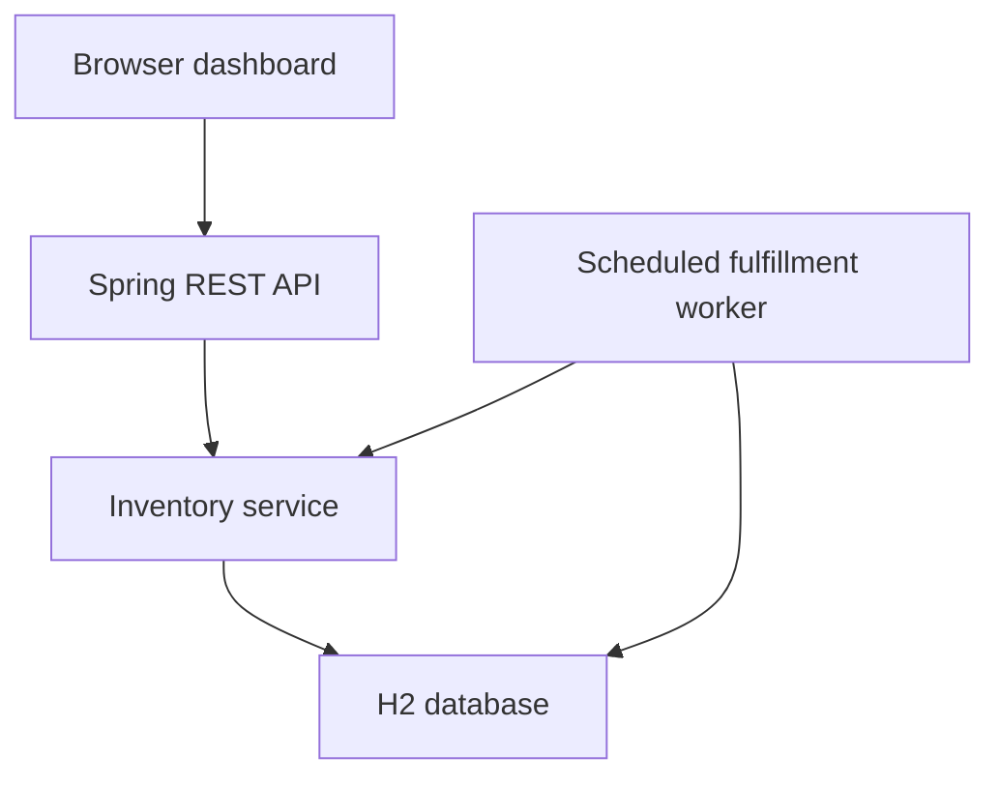

# Stockline

A multi-warehouse inventory and order management project built with Java 17, Spring Boot, Spring JDBC, PostgreSQL or H2, and a browser dashboard. The app reserves stock across warehouses and fulfills orders through a durable background queue.

## Run from source

Extract the ZIP and open the **Stockline** folder in VS Code. The folder contains the Maven project file `pom.xml`.

Install Java 17 and Maven. Open a terminal in the same folder and run these commands.

```sh
mvn clean verify
java -jar target/stockline-1.0.0.jar
```

Open [http://localhost:8080](http://localhost:8080). Stop the server with **Ctrl+C**.

The build packages the dashboard, web server, and database engine in an executable JAR. The first launch seeds three warehouses and five products. The database file is created under `data/` in the working directory. Orders, stock changes, and pending events persist across restarts. Run from the same folder to reopen the same database.

If port 8080 is occupied, run `java -jar target/stockline-1.0.0.jar --server.port=8081` and open [http://localhost:8081](http://localhost:8081).

## PostgreSQL with Docker Compose

For the PostgreSQL-backed deployment, copy `.env.example` to `.env` and replace the example password with a strong local value. Then start both services:

```sh
cp .env.example .env
docker compose up --build
```

Compose waits for PostgreSQL's readiness check before starting the app. Open [http://localhost:8080](http://localhost:8080); check progress with `docker compose logs -f app`. Stop services with `docker compose down`. The `stockline-postgres` volume preserves database data across restarts and `down`; `docker compose down -v` removes the volume and its data.

The local H2 profile remains the default (`dev`) and stores its database in `data/`. `test` uses in-memory H2. `postgres` and `prod` require `DB_URL`, `DB_USERNAME`, and `DB_PASSWORD`; pool sizes and connection timeout can be set with `DB_POOL_MAX`, `DB_POOL_MIN_IDLE`, and `DB_CONNECTION_TIMEOUT_MS`.

Flyway migrations are under `src/main/resources/db/migration/`. New databases apply V1 through the latest version. A non-empty pre-Flyway database is baselined at version 0 and receives the idempotent migrations without replaying seed inserts or changing balances. The migrations do not drop application tables. Back up a production database before deploying any application upgrade.

## Walkthrough

| Screen | What to try |
| --- | --- |
| Overview | See available, reserved, and shipped totals and compare stock across locations. |
| Catalog | Add a product or a warehouse. Stock records start at zero for new product–warehouse combinations. |
| Inventory | Compare product-level network totals with every warehouse balance. Search by SKU or product name, filter warehouse rows, restock, or transfer available units. |
| Orders | Optionally choose a preferred warehouse; Stockline evaluates other locations when needed and can split fulfillment. View exact allocations and filter by status. |
| Event Log | See whether each reservation event is pending, processed, or cancelled. |
| Inventory History | Search the movement ledger, review warehouse thresholds and run bucket-level reconciliation. |
| Concurrency Lab | Compare real database-backed naive, optimistic, and pessimistic reservations using fresh isolated H2 databases. Inspect correctness, ledger integrity, lock waits, retries, and latency. |

### Five-minute classroom demo

1. In a fresh database, place a **10-unit order for KB-104**. Punjab Central supplies eight units and North Hub supplies two. The detail dialog shows both allocations.
2. Add iPhone 17 if needed, then restock Punjab Central with 50, North Hub with 30, and South Hub with 20. Place a 50-unit order with Punjab Central selected. Punjab reports zero available while the network still has 50 and the product stays available. Place another 50-unit order with Punjab selected. The allocator uses North and South, and the network status becomes out of stock. The view reads persisted inventory rows.
3. Wait about **12 seconds**. The background worker marks the pending orders fulfilled. Reserved balances drop and shipped balances increase.
4. Place a second order and select **Cancel order**, then **Confirm cancellation** while the order is reserved. The exact allocated units return to their warehouses.
5. Run **Concurrency Lab** with 100 buyers, 10 starting units, and one unit per buyer. Compare all three transaction strategies. In the deterministic H2 setup, naive mode can accept stale reads and report lost reservations; optimistic and pessimistic modes should accept at most 10. Optimistic mode uses the production version-checked service; pessimistic mode takes ordered row locks.
6. Try 50 buyers with 11 units and three units per buyer. Expect three accepted orders, 47 rejected orders, and two remaining units in either safe strategy.

The lab supports 10, 50, 100, 250, 500, or 1,000 buyers, configurable stock, warehouse count, quantity, worker count, maximum duration, one to five repetitions, and an individual or comparison run. Combined requested simulation time is capped at 15 minutes. Each strategy starts with a fresh H2 database populated from the same schema and stock distribution. All three execute database transactions at `READ_COMMITTED`; only the naive simulation uses a coordination barrier, after database reads, to make stale read-modify-write collisions reproducible. No barrier is used by production reservations. At this isolation level, H2 permits a read to become stale before an unguarded write; other engines or stricter isolation may serialize or abort the same race. Optimistic conflicts count actual failed version predicates; retries count fresh attempts. Pessimistic wait time measures time spent acquiring ordered `SELECT FOR UPDATE` locks. Request latency includes queue time; the UI separately reports summed queue wait and cumulative transaction execution time, subtracting simulation-only barrier duration. Naive transactions may commit inconsistent ledger chains by design, but the database is disposed after the run and production inventory is never connected. H2 results demonstrate correctness and local behavior; they are not production-scale performance claims.

## How it works



- **Allocation.** The service merges duplicate SKU lines. An optional `preferredWarehouseCode` is evaluated first; the other candidates retain warehouse priority. If it cannot satisfy a line, the allocator falls back to other locations and can split units across warehouses. The complete plan is reserved in one transaction.
- **Optimistic concurrency.** Every stock row carries a version. The update includes `WHERE sku = ? AND warehouse_code = ? AND version = ?` and increments the version when it succeeds. When a concurrent change makes a snapshot stale, the update affects zero rows. The service rolls back and retries in a fresh transaction with current balances.
- **Concurrency strategy lab.** `RaceStrategy` separates naive, optimistic, and pessimistic implementations. Every run owns a disposable in-memory H2 database initialized from Flyway migrations; all begin from the same warehouse distribution and use `READ_COMMITTED`. The naive strategy writes stale absolute balances without a version predicate or explicit lock. Optimistic mode calls `InventoryService.place`. Pessimistic mode locks rows with `SELECT FOR UPDATE`, ordered by SKU and warehouse code, before planning a split reservation. Each database transaction commits orders, allocations, outbox events, stock changes, and ledger movements atomically.
- **Atomicity.** The order, allocations, available-to-reserved movements, and outbox event commit together. A failed line leaves the whole order uncommitted. Transfers also commit both warehouse changes together. Stock writers use a consistent SKU and warehouse-code order.
- **Durable events.** The worker reads due events from the database. It moves reserved stock to shipped stock, marks the order fulfilled, and closes the event in one transaction. If the process stops, committed pending events remain eligible after restart.
- **Cancellation.** The worker and cancel action both update the order only while its status is `RESERVED`. One transition wins. Cancellation returns reserved stock to the original allocations and closes the event in the same transaction.
- **Duplicate requests.** `requestKey` is a client-generated UUID stored under a unique constraint. Repeating a successful request with the same customer and SKU quantities returns the existing order. Using that key with a changed payload returns a conflict.

The app runs as a single local process with file-backed H2. Fulfillment models the internal stock and order transition. Lower warehouse priority numbers allocate first. The inventory dashboard considers five or fewer available units low stock.

## Inventory ledger and audit

Stock balances distinguish **available**, **reserved**, **damaged**, **shipped**, and **written off** units. Physical units at a warehouse are `available + reserved + damaged`; shipped and written-off quantities are tracked outside physical stock. Reservation moves units from available to reserved, cancellation reverses that move, fulfillment moves reserved to shipped, damage moves available to damaged, write-off moves damaged out of physical stock, and returns move shipped units back to available. Transfers create matching source and destination movements. Reconciliation compares each bucket independently, so transfers do not duplicate stock across warehouses.

Every nonzero bucket change writes a movement with before/after balances, movement type, timestamp, reason, actor, correlation ID, and optional order and transfer references. Inventory updates, operation keys, and movements share the same JDBC transaction; an insertion failure rolls back the stock update. Existing file-backed databases receive one-time `INITIAL_STOCK` opening entries after schema/data initialization. New warehouse/product stock rows begin at zero. There is no authentication layer, so recorded actors are `system`.

Use a stable `requestKey` UUID when calling restock, transfer, adjustment, damage, write-off, or return APIs. Replaying a matching key does not repeat the stock change; reusing it with a different payload returns a conflict. The current inventory UI supplies the key automatically.

Inventory thresholds are stored per product and warehouse and default to five units for seeded or newly created stock rows. Update them from the Inventory table. Replenishment recommendations equal `max(0, minimum available - available)`.

Manual inventory adjustments are limited to `AVAILABLE` and `DAMAGED`; reserved, shipped, and written-off quantities change only through their order or stock workflows. Movement history sorts equal timestamps by a database-generated sequence. Existing H2 ledgers receive this sequence column during schema initialization without changing movement IDs or ledger contents. Optimistic and database-lock conflicts retry up to `stockline.retry.max-attempts` (default 8), with full jitter and a capped exponential delay (`stockline.retry.base-delay=2ms`, `stockline.retry.max-delay=100ms`). Stock shortages remain conflicts; exhausted retries and unavailable database resources return service-unavailable responses.

| Endpoint | Purpose |
| --- | --- |
| `GET /api/inventory/movements?search=&warehouseCode=&type=&from=&to=&orderId=&limit=&offset=` | Filter real ledger rows by product/SKU, warehouse, movement type, timestamp range, or order. |
| `GET /api/inventory/products` | Read current network-wide stock totals and all warehouse balances and availability statuses for each product. |
| `POST /api/inventory/adjustments` | Apply a signed correction with a required reason and `requestKey`. |
| `POST /api/inventory/damaged` / `POST /api/inventory/write-offs` | Record damage or remove damaged units with a required reason and key. |
| `POST /api/inventory/returns` | Return shipped units against a fulfilled order allocation. |
| `POST /api/inventory/threshold` / `GET /api/inventory/alerts` | Configure minimum available stock and inspect real replenishment alerts. |
| `GET /api/inventory/reconciliation` | Compare ledger totals with available, reserved, damaged, shipped, and written-off balances. |

Reconciliation reports differences without changing stock. Correct a discrepancy only through an explicit inventory adjustment, which adds its own reasoned movement. The `inventory` schema adds damaged and written-off balances; `inventory_operations`, `inventory_movements`, and `stock_thresholds` hold idempotency, ledger, and threshold data.

## Source and tests

Open `pom.xml` as a Maven project. For source changes, use Java 17 and Maven.

```sh
mvn clean verify
java -jar target/stockline-1.0.0.jar
```

`InventoryServiceTest` runs against real H2 transactions. It covers preferred-warehouse fallback, split fulfillment, the iPhone 17 network-availability scenario, concurrent reservations across warehouses, all-or-nothing orders, repeated cancellation and fulfillment, concurrent duplicate orders and transfers, cancellation racing the worker, catalog initialization, and forced stock contention.

| Method and path | Purpose |
| --- | --- |
| `GET /api/overview` | Inventory and order totals |
| `GET /api/catalog` | Products and warehouses |
| `POST /api/products`, `POST /api/warehouses` | Add catalog records |
| `GET /api/inventory` | Stock balances and versions |
| `POST /api/inventory/restock`, `POST /api/inventory/transfer` | Manage available stock |
| `GET /api/inventory/movements`, `GET /api/inventory/reconciliation` | Inspect ledger history and compare it with current balances |
| `GET /api/orders` | Filter and paginate orders using `status`, `limit`, and `offset` |
| `POST /api/orders` | Reserve stock and enqueue an order |
| `GET /api/orders/{id}` | Inspect status and allocations |
| `POST /api/orders/{id}/cancel` | Cancel a reserved order |
| `GET /api/events` | Inspect recent outbox events |
| `POST /api/demo/race` | Run the isolated concurrency comparison synchronously |
| `POST /api/demo/race/jobs` | Start a configurable asynchronous isolated simulation |
| `GET /api/demo/race/jobs/{id}` | Read live progress or completed results for a simulation |

Example order body for `POST /api/orders`. `preferredWarehouseCode` is optional; when supplied, Stockline tries that warehouse first and then evaluates other warehouses.

```json
{
  "customer": "Demo buyer",
  "requestKey": "93d09806-b33a-4838-94f9-e0bd524b9e1d",
  "preferredWarehouseCode": "PUN",
  "lines": [
    { "sku": "KB-104", "quantity": 10 },
    { "sku": "CB-305", "quantity": 2 }
  ]
}
```

A new reservation returns HTTP 201 with the order URL. A successful replay returns HTTP 200 with `Idempotent-Replay: true`. Validation failures return HTTP 400. Stock shortages, changed requests using an existing key, and attempts to cancel fulfilled orders return HTTP 409. Use `Content-Type: application/json` for mutations and send `{}` for the cancel request.

Set `--stockline.fulfillment-delay=30s` at startup if you want a longer reservation window for the demo.
